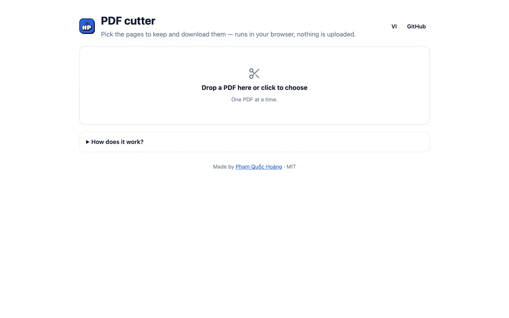

# PDF Cutter

Cắt file PDF ngay trên trình duyệt: xem trước từng trang, chọn trang cần giữ rồi tải về — file không được tải lên server nào.

**Dùng thử:** https://hoangpham.is-a.dev/pdf-cutter/



## Tính năng

- Xem trước tất cả các trang dạng ảnh nhỏ.
- Bấm để chọn / bỏ chọn trang, hoặc dùng "Chọn tất cả", "Bỏ chọn", "Đảo chọn".
- Phím tắt: `Shift` + bấm để chọn cả khoảng, `Ctrl/⌘ + A` chọn tất cả, `Ctrl/⌘ + I` đảo chọn, `Esc` bỏ chọn, `Ctrl/⌘ + S` tải PDF.
- Gõ nhanh trang cần giữ: `1-3, 5, 8` hoặc `4-` (từ trang 4 đến hết).
- Tải 1 file PDF gồm các trang đã chọn, hoặc tách mỗi trang thành 1 file (ZIP).
- Giao diện tiếng Việt / English, hỗ trợ dark mode.

## Cách hoạt động

- Ảnh xem trước vẽ bằng [PDF.js](https://mozilla.github.io/pdf.js/).
- Cắt trang bằng [pdf-lib](https://pdf-lib.js.org/): chép nguyên các trang được chọn sang file mới, nên chữ, link và chất lượng giữ nguyên.
- Đóng gói ZIP bằng [fflate](https://github.com/101arrowz/fflate).

Không cần build — chỉ là HTML, CSS, JavaScript. Chạy local:

```bash
python3 -m http.server 8000
```

## License

MIT © Phạm Quốc Hoàng
